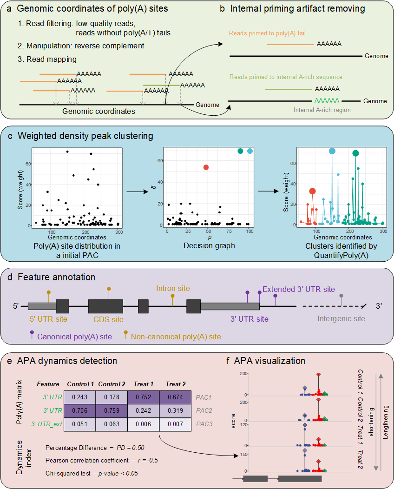

# QuantifyPoly(A)

**Quantification of poly(A) site usage from 3' end sequencing data**

[](https://github.com/yec-bioinfo/QuantifyPolyA/actions/workflows/R-CMD-check.yaml)
[-blue.svg)](https://www.gnu.org/licenses/gpl-3.0)
[](https://yec-bioinfo.github.io/QuantifyPolyA/)

The tool is called **QuantifyPoly(A)**. It is distributed as the R package
`QuantifyPolyA`, because R does not allow parentheses in package names, so the
install commands, the function calls and the `QuantifyPolyA` class all spell
the name without parentheses.

QuantifyPoly(A) is a complete and seamless R package for accurately quantifying
poly(A) site usages under diverse biological conditions. It employs a weighted
density peak clustering algorithm to address the innate microheterogeneity of
cleavage and polyadenylation.



The schematic diagram of QuantifyPoly(A): (a) input preparation, (b) internal
priming artifact removal, (c) poly(A) site clustering, (d) feature annotation,
(e) APA dynamics detection, (f) APA visualization.

## Installation

The package is not on CRAN. Install the development version from GitHub:

```r
# install from GitHub (dependencies are resolved automatically)
if (!requireNamespace("remotes", quietly = TRUE)) install.packages("remotes")
remotes::install_github("yec-bioinfo/QuantifyPolyA")

# or with pak
# pak::pkg_install("yec-bioinfo/QuantifyPolyA")
```

`ggalt` is distributed on GitHub rather than CRAN; the `Remotes` field in
`DESCRIPTION` makes `remotes`/`pak` fetch it automatically. Bioconductor
dependencies are available for R >= 4.0 via `BiocManager`.

To install from a local source tarball:

```r
install.packages("QuantifyPolyA_0.4.0.tar.gz", repos = NULL, type = "source")
```

Note that R does **not** install dependencies for a local tarball; use
`remotes::install_local("QuantifyPolyA_0.4.0.tar.gz", dependencies = TRUE)`
or install the dependencies listed in `DESCRIPTION` first.

## Quick start

```r
library(QuantifyPolyA)

#1. Load raw poly(A) site data (one file per sample)
QpolyA <- Load.PolyA(dir = "./Test")

#2. Remove internal priming artifacts
QpolyA <- Remove.IP(QpolyA, fasta = "Genome.fasta")

#3. Cluster poly(A) sites into PACs
QpolyA <- Cluster.PolyA(QpolyA, max.gapwidth = 24, mc.cores = 4)

#4. Annotate and quantify PACs
QpolyA <- Annotate.PolyA(QpolyA, gff = "Genome.annotation.gtf")

#5. Quantify APA dynamics between two conditions
colData <- data.frame(
 condition = c(rep("Control",2), rep("Treatment",2)),
 type = "single-end"
)
rownames(colData) <- QpolyA@sample_names
split.APA <- Quantify.SplitAPA(QpolyA, colData,
 contrast = c("condition", "Control", "Treatment"))
```

## Documentation

The user manual is published as a web page, so no R installation is needed to
read it:

- **Online manual**: <https://yec-bioinfo.github.io/QuantifyPolyA/articles/QuantifyPolyA.html>
- **Function reference**: <https://yec-bioinfo.github.io/QuantifyPolyA/reference/>
- **Package home page**: <https://yec-bioinfo.github.io/QuantifyPolyA/>

The same manual ships with the package as a vignette, and every function has
its own help page:

```r
vignette("QuantifyPolyA")
?Remove.IP
```

The manual for version 0.3.0 is still available on SourceForge:
<https://sourceforge.net/p/quantifypoly-a/wiki/User%20Manual/>

## Main functions

| Function | Purpose |
|---|---|
| `Load.PolyA()` | Load raw poly(A) site files |
| `Remove.IP()` | Remove internal priming artifacts |
| `Cluster.PolyA()` | Cluster sites into PACs (weighted density peak clustering) |
| `Annotate.PolyA()` | Annotate PACs and build the PAC matrix |
| `Filter.PolyA()` | Filter PACs with low read support |
| `Quantify.SplitAPA()` | APA dynamics among split PACs |
| `Quantify.CanonicalAPA()` | APA dynamics among 3' UTR PACs |
| `Quantify.CNCAPA()` | Canonical vs. non-canonical PAC dynamics |
| `Quantify.GeneAPA()` | APA dynamics across a whole gene |
| `Visualize.PolyA()` | Plot poly(A) profiles of a gene |
| `DESeq2.PolyA()` | Differential PAC analysis with DESeq2 |

## Input format

Raw poly(A) site files are tab-separated with four columns:

| Column | Explanation |
|---|---|
| `seqnames` | Chromosome or contig name |
| `strand` | `+` or `-` |
| `coord` | Genomic coordinate of the poly(A) site |
| `score` | Number of reads supporting the site |

## Citation

> Ye C, Zhao D, Ye W, Wu X, Ji G, Li QQ, Lin J (2021).
> QuantifyPoly(A): reshaping alternative polyadenylation landscapes of
> eukaryotes with weighted density peak clustering.
> *Briefings in Bioinformatics*. doi:10.1093/bib/bbab268

```r
citation("QuantifyPolyA")
```

## Contact

Congting Ye <yec@xmu.edu.cn>

Please report bugs at <https://github.com/yec-bioinfo/QuantifyPolyA/issues>.
