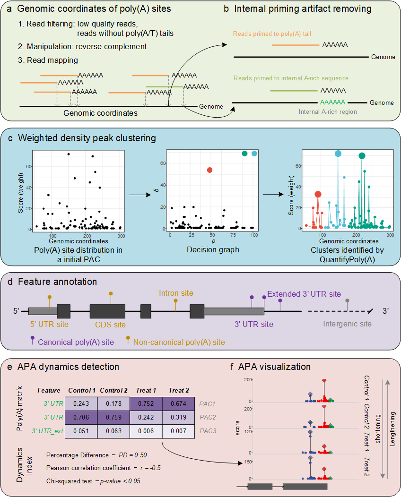

# QuantifyPoly(A): User Manual

## What is QuantifyPoly(A)?

QuantifyPoly(A) is a complete and seamless R package for accurately
quantifying poly(A) site usages under diverse biological conditions. It
employs a weighted density peak clustering algorithm to address the
innate microheterogeneity of cleavage and polyadenylation.

The tool is called **QuantifyPoly(A)**. It is distributed as the R
package `QuantifyPolyA`, because R does not allow parentheses in package
names, so the install commands, the function calls and the
`QuantifyPolyA` class all spell the name without parentheses.

If you have any question or comment, please contact Dr. Congting Ye
(<yec@xmu.edu.cn>). You can also report a bug at
<https://github.com/yec-bioinfo/QuantifyPolyA/issues>.

``` r

citation("QuantifyPolyA")
```

## Installation

### System requirements

SAMtools, bedtools and R (\>= 4.0) are required.

### Install from GitHub

QuantifyPoly(A) is not distributed through CRAN. The recommended
installation resolves all dependencies automatically:

``` r

if (!requireNamespace("remotes", quietly = TRUE)) {
 install.packages("remotes")
}
remotes::install_github("yec-bioinfo/QuantifyPolyA")
```

Bioconductor dependencies require R \>= 4.0; `remotes` installs them
through `BiocManager`. The `ggalt` package is hosted on GitHub rather
than CRAN, and is declared in the `Remotes` field of `DESCRIPTION` so
that `remotes` and `pak` pick it up automatically.

### Install from a source tarball

Download `QuantifyPolyA_0.4.0.tar.gz` from the GitHub releases page,
then:

``` r

install.packages("QuantifyPolyA_0.4.0.tar.gz", repos = NULL, type = "source")
```

R does **not** resolve dependencies when installing a local tarball.
Either use
`remotes::install_local("QuantifyPolyA_0.4.0.tar.gz", dependencies = TRUE)`
or install the packages listed in `DESCRIPTION` first.

## How to run QuantifyPoly(A)

There are six major steps: (a) input preparation, (b) internal priming
artifact removal, (c) poly(A) site clustering, (d) feature annotation,
(e) APA dynamics detection, and (f) APA visualization.



The schematic diagram of QuantifyPoly(A).

### (a) Load raw poly(A) site data

Load the raw poly(A) site information extracted from 3’ end sequencing
data.

Load all files located in a directory:

``` r

QpolyA <- Load.PolyA(dir = "./Test")
```

Or load specified files:

``` r

QpolyA <- Load.PolyA(files = c(
 "Control1.bed", "Control2.bed",
 "Treatment1.bed", "Treatment2.bed"
))
```

Arguments:

- `files`: a character vector specifying the names of files containing
  poly(A) site information. Each file contains four columns: `seqnames`,
  `strand`, `coord` and `score`.
- `dir`: a string specifying the directory of the files.

### (b) Remove internal priming artifacts

Remove poly(A) sites that potentially result from internal priming
events.

``` r

QpolyA <- Remove.IP(QpolyA, fasta = "Genome.fasta")
```

Arguments:

- `QpolyA`: a `QuantifyPolyA` object containing all raw poly(A) sites.
- `fasta`: a string specifying the location and name of the
  corresponding genome file in FASTA format.
- `flank_len`: the neighborhood (in bp) searched on each side of a
  poly(A) site for a template poly(A) stretch. Default `15`.
- `win_size`: the size of the sliding window, in bp. Default `10`.
- `min_A`: the minimum number of consecutive adenines in a window for a
  site to be flagged as internal priming. Default `8`.

A site is called an internal priming artifact if the genomic sequence
around it contains a run of at least `min_A` adenines (thymines on the
minus strand) within any `win_size`-bp window inside
`coord +/- flank_len`.

**Changed in 0.4.0.** These three arguments previously did not exist and
the values were hard-coded (`flank_len = 10`, `win_size = 10`,
`min_A = 7`). Because the defaults are now `15`, `10` and `8`, results
are not identical to version 0.3.0. To reproduce the old behaviour:

``` r

QpolyA <- Remove.IP(QpolyA, fasta = "Genome.fasta",
 flank_len = 10, win_size = 10, min_A = 7)
```

### (c) Cluster poly(A) sites

Cluster poly(A) sites into poly(A) site clusters (PACs) using a weighted
density peak clustering algorithm.

``` r

QpolyA <- Cluster.PolyA(QpolyA, max.gapwidth = 24, mc.cores = 4)
```

Arguments:

- `QpolyA`: a `QuantifyPolyA` object containing clean poly(A) sites.
- `max.gapwidth`: a cutoff limiting the maximum distance between two
  adjacent poly(A) sites in a PAC. Default `24`.
- `mc.cores`: the number of processors/cores used for clustering.
  Default `4`.

### (d) Annotate and quantify poly(A) site clusters

Annotate PACs based on existing genome annotations and generate the PAC
table for all experimental samples.

``` r

QpolyA <- Annotate.PolyA(QpolyA, gff = "Genome.annotation.gtf",
 seq.levels = NA)
```

Arguments:

- `QpolyA`: a `QuantifyPolyA` object containing clean poly(A) sites and
  PACs.
- `gff`: a genome annotation file in GFF/GTF format; GTF is recommended.
- `seq.levels`: a character vector of chromosome/contig names. Useful
  when the names in the genome file and the annotation file are not
  consistent.

Annotations are read with
[`txdbmaker::makeTxDbFromGFF()`](https://rdrr.io/pkg/txdbmaker/man/makeTxDbFromGFF.html).
`makeTxDbFromGFF()` lived in GenomicFeatures before Bioconductor 3.19
and was removed from it in Bioconductor 3.23, which is why **txdbmaker**
is now a dependency.

Optionally, PACs with low read support can be discarded before
downstream analysis:

``` r

QpolyA <- Filter.PolyA(QpolyA, min_count = 10, min_sample = 1)
```

### (e) Quantify APA dynamics

Identify APA usage patterns of genes that differ significantly between
two samples, treatments or conditions. Dynamics detection can be
performed on different categories of poly(A) sites: canonical APA (PACs
located in the 3’ UTR), non-canonical APA (PACs in intragenic regions
excluding the 3’ UTR), and split APA (PACs recovered through the
secondary clustering step).

The experimental design is described by a `data.frame` whose row names
are the sample names:

``` r

colData <- data.frame(
 condition = c(rep("Control",2), rep("Treatment",2)),
 type = "single-end"
)
rownames(colData) <- QpolyA@sample_names
```

#### Among split PACs

``` r

split.APA <- Quantify.SplitAPA(
 QpolyA, colData,
 contrast = c("condition", "Control", "Treatment")
)
```

#### Among canonical PACs

``` r

canonical.APA <- Quantify.CanonicalAPA(
 QpolyA, colData,
 contrast = c("condition", "Control", "Treatment")
)
```

#### Canonical vs. non-canonical PACs

``` r

cnc.APA <- Quantify.CNCAPA(
 QpolyA, colData,
 contrast = c("condition", "Control", "Treatment")
)
```

#### Across a whole gene

``` r

gene.APA <- Quantify.GeneAPA(
 QpolyA, colData,
 contrast = c("condition", "Control", "Treatment")
)
```

Common arguments:

- `QpolyA`: a `QuantifyPolyA` object generated after clustering and
  annotation.
- `colData`: a `data.frame` describing the experimental design.
- `contrast`: a three-element vector specifying the two conditions to
  compare, e.g. `contrast = c("condition", "Control", "Treatment")`.

### (f) Visualize poly(A) profiles

Visualize the poly(A) profiles of a specific gene across multiple
samples.

``` r

library(rtracklayer)
anno <- import("Genome.annotation.gtf")

gene_id <- "XXXXXXXX"
dp <- Visualize.PolyA(QpolyA, anno, gene_id)

library(ggsci)
dp + scale_color_aaas() + scale_fill_aaas()
```

Arguments:

- `QpolyA`: a `QuantifyPolyA` object containing clean poly(A) sites and
  the PAC table.
- `anno`: a `GRanges` object of gene model information, generated for
  example with `rtracklayer::import()`.
- `gene.id`: a string indicating the gene to be visualized, e.g.
  `gene.id = "ENSMUSG00000073490"`.
- `sample.names`: a character vector specifying the samples to display.
  All samples are shown if omitted.
- `coord.lim`: two numeric values specifying the left and right limits
  of the x-axis.

The returned object is a `ggplot2` object that can be customized with
standard `ggplot2` functions.

## Demos

The demo datasets are available from the *Files* tab of the [SourceForge
project page](https://sourceforge.net/projects/quantifypoly-a/files/).

### Arabidopsis dataset

Prepare the data:

1.  Download the three files:
    - demo data:
      [`Arabidopsis_FY.zip`](https://sourceforge.net/projects/quantifypoly-a/files/)
      (from the *Files* tab of the SourceForge project page)
    - TAIR10 genome:
      [`TAIR10_chr_all.fas`](https://www.arabidopsis.org/download_files/Genes/TAIR10_genome_release/TAIR10_chromosome_files/TAIR10_chr_all.fas)
      (from TAIR)
    - annotation:
      [`Arabidopsis_thaliana.TAIR10.45.gtf.gz`](https://ftp.ensemblgenomes.ebi.ac.uk/pub/plants/release-45/gtf/arabidopsis_thaliana/Arabidopsis_thaliana.TAIR10.45.gtf.gz)
      (from EnsemblPlants)
2.  Move the three files to the working directory and unzip them.

``` r

library(QuantifyPolyA)

#1. Load raw poly(A) site data.
QpolyA <- Load.PolyA(dir = "./Arabidopsis_FY")

#2. Remove internal priming artifacts.
QpolyA <- Remove.IP(QpolyA, "TAIR10_chr_all.fas")

#3. Cluster poly(A) sites.
QpolyA <- Cluster.PolyA(QpolyA, max.gapwidth = 24, mc.cores = 16)

#4. Annotate and quantify poly(A) site clusters.
QpolyA <- Annotate.PolyA(
 QpolyA, "Arabidopsis_thaliana.TAIR10.45.gtf",
 seq.levels = as.character(unique(QpolyA@polyA$seqnames))
)

#5. Filter out PACs with low read count support.
QpolyA <- Filter.PolyA(QpolyA, min_count = 10, min_sample = 1)

#6. Quantify APA dynamics.
colData <- data.frame(
 condition = c(rep("fy3",3), rep("fy3oxt6",3),
 rep("oxt6",3), rep("wt",3)),
 type = "single-end"
)
rownames(colData) <- QpolyA@sample_names

split.APA <- Quantify.SplitAPA(QpolyA, colData, contrast = c("condition", "wt", "oxt6"))
canonical.APA <- Quantify.CanonicalAPA(QpolyA, colData, contrast = c("condition", "wt", "oxt6"))
cnc.APA <- Quantify.CNCAPA(QpolyA, colData, contrast = c("condition", "wt", "oxt6"))
gene.APA <- Quantify.GeneAPA(QpolyA, colData, contrast = c("condition", "wt", "oxt6"))

#7. Visualize poly(A) profiles.
library(rtracklayer)
anno <- import("Arabidopsis_thaliana.TAIR10.45.gtf")

gene_id <- "AT1G01140"
dp <- Visualize.PolyA(QpolyA, anno, gene_id, sample.names = c("wt", "fy3oxt6"))

library(ggsci)
dp + scale_color_aaas() + scale_fill_aaas()

#8. Perform DESeq2 analysis.
res <- DESeq2.PolyA(QpolyA, colData)

library(DESeq2)
compare_wt_oxt6 <- results(res$DESeq2.Result,
 contrast = c("condition", "wt", "oxt6"))
compare_wt_oxt6.df <- as.data.frame(compare_wt_oxt6)

summary(compare_wt_oxt6)
sum(compare_wt_oxt6$padj < 0.05, na.rm = TRUE)

res$PCA.Plot
```


Illustration of gene CIPK9 showing dynamic APA profiles between wild
type (wt) and double mutant (fy3oxt6) samples.


The PCA plot based on the PAC matrix (Arabidopsis dataset).

### Human dataset

Prepare the data:

1.  Download the three files:
    - demo data:
      [`Human_MAQC.zip`](https://sourceforge.net/projects/quantifypoly-a/files/)
      (from the *Files* tab of the SourceForge project page)
    - genome:
      [`Homo_sapiens.GRCh38.dna.primary_assembly.fa.gz`](https://ftp.ensembl.org/pub/release-101/fasta/homo_sapiens/dna/Homo_sapiens.GRCh38.dna.primary_assembly.fa.gz)
      (from Ensembl)
    - annotation:
      [`Homo_sapiens.GRCh38.101.gtf.gz`](https://ftp.ensembl.org/pub/release-101/gtf/homo_sapiens/Homo_sapiens.GRCh38.101.gtf.gz)
      (from Ensembl)
2.  Move the three files to the working directory and unzip them.

``` r

library(QuantifyPolyA)

#1. Load raw poly(A) site data.
QpolyA <- Load.PolyA(dir = "./Human_MAQC")

#2. Remove internal priming artifacts.
QpolyA <- Remove.IP(QpolyA, "Homo_sapiens.GRCh38.dna.primary_assembly.fa")

#3. Cluster poly(A) sites.
QpolyA <- Cluster.PolyA(QpolyA, max.gapwidth = 24, mc.cores = 16)

#4. Annotate and quantify poly(A) site clusters.
QpolyA <- Annotate.PolyA(QpolyA, "Homo_sapiens.GRCh38.101.gtf")

#5. Filter out PACs with low read count support.
QpolyA <- Filter.PolyA(QpolyA, min_count = 10, min_sample = 1)

#6. Quantify APA dynamics.
colData <- data.frame(
 condition = c(rep("Brain",2), rep("UHR",2)),
 type = "single-end"
)
rownames(colData) <- QpolyA@sample_names

split.APA <- Quantify.SplitAPA(QpolyA, colData, contrast = c("condition", "Brain", "UHR"))
canonical.APA <- Quantify.CanonicalAPA(QpolyA, colData, contrast = c("condition", "Brain", "UHR"))
cnc.APA <- Quantify.CNCAPA(QpolyA, colData, contrast = c("condition", "Brain", "UHR"))
gene.APA <- Quantify.GeneAPA(QpolyA, colData, contrast = c("condition", "Brain", "UHR"))

#7. Visualize poly(A) profiles.
library(rtracklayer)
anno <- import("Homo_sapiens.GRCh38.101.gtf")

gene_id <- "ENSG00000164091"
dp <- Visualize.PolyA(QpolyA, anno, gene_id, coord.lim = c(52254310,52255210))

library(ggsci)
dp + scale_color_aaas() + scale_fill_aaas()

#8. Perform DESeq2 analysis.
res <- DESeq2.PolyA(QpolyA, colData)

library(DESeq2)
compare_Brain_UHR <- results(res$DESeq2.Result,
 contrast = c("condition", "Brain", "UHR"))
compare_Brain_UHR.df <- as.data.frame(compare_Brain_UHR)

summary(compare_Brain_UHR)
sum(compare_Brain_UHR$padj < 0.05, na.rm = TRUE)

res$PCA.Plot
```


Illustration of gene PCNX1 showing dynamic APA profiles between brain
and UHR samples.


The PCA plot based on the PAC matrix (human dataset).

## Inputs

The main inputs are the raw poly(A) data (one file per sample)
containing the genomic coordinates of poly(A) sites, together with the
corresponding genome sequence and genome annotation files.

### Generating raw poly(A) site data

Use commonly used aligners such as STAR or HISAT2, and pipelines such as
PlantAPAdb or PolyASite, to align3’ end sequencing reads and extract the
genomic coordinates of poly(A) sites.

### Format of raw poly(A) site data

Tab-separated files with four columns:

| Column     | Explanation                                           |
|------------|-------------------------------------------------------|
| `seqnames` | Chromosome or contig name                             |
| `strand`   | `+` or `-`, indicating the strand of the poly(A) site |
| `coord`    | Coordinate of the poly(A) site                        |
| `score`    | Number of reads supporting the site                   |

## Outputs

### Output of preprocessing (steps a-d)

A `QuantifyPolyA` object with five slots:

| Slot | Explanation |
|----|----|
| `sample_names` | Character vector of sample names, taken from the input file names |
| `pre.polyA` | List of un-clustered poly(A) sites |
| `polyA` | `data.frame` of PACs generated by weighted density peak clustering |
| `simple.clusters` | `data.frame` of PACs generated by k-nt iterative clustering |
| `split.clusters` | `data.frame` of the split PACs only |

### Output of APA dynamics detection (step e)

A tibble containing APA dynamics metrics for all split PACs or genes:

| Column | Explanation |
|----|----|
| `split_label` or `gene_id` | Group label of the split PACs, or a gene ID |
| `pd` | Percentage difference, measuring dynamics induced by condition changes |
| `r` | Averaged Pearson correlation coefficient, indicating lengthening/shortening |
| `p.value` | Statistical test p-value |

### Output of APA visualization (step f)

A `ggplot2` object that can be customized with standard `ggplot2`
functions. See the demos above for examples.

## Session information

``` r

sessionInfo()
#> R version 4.6.2 (2026-10-29)
#> Platform: x86_64-pc-linux-gnu
#> Running under: Ubuntu 24.04.5 LTS
#> 
#> Matrix products: default
#> BLAS:   /usr/lib/x86_64-linux-gnu/openblas-pthread/libblas.so.3 
#> LAPACK: /usr/lib/x86_64-linux-gnu/openblas-pthread/libopenblasp-r0.3.26.so;  LAPACK version 3.12.0
#> 
#> locale:
#>  [1] LC_CTYPE=C.UTF-8       LC_NUMERIC=C           LC_TIME=C.UTF-8       
#>  [4] LC_COLLATE=C.UTF-8     LC_MONETARY=C.UTF-8    LC_MESSAGES=C.UTF-8   
#>  [7] LC_PAPER=C.UTF-8       LC_NAME=C              LC_ADDRESS=C          
#> [10] LC_TELEPHONE=C         LC_MEASUREMENT=C.UTF-8 LC_IDENTIFICATION=C   
#> 
#> time zone: UTC
#> tzcode source: system (glibc)
#> 
#> attached base packages:
#> [1] stats     graphics  grDevices utils     datasets  methods   base     
#> 
#> loaded via a namespace (and not attached):
#>  [1] digest_0.6.39     desc_1.4.3        R6_2.6.1          fastmap_1.2.0    
#>  [5] xfun_0.62         cachem_1.1.0      knitr_1.52        htmltools_0.5.9  
#>  [9] rmarkdown_2.32    lifecycle_1.0.5   cli_3.6.6         sass_0.4.10      
#> [13] pkgdown_2.2.1     textshaping_1.0.5 jquerylib_0.1.4   systemfonts_1.3.2
#> [17] compiler_4.6.2    tools_4.6.2       ragg_1.5.2        bslib_0.12.0     
#> [21] evaluate_1.0.5    yaml_2.3.12       otel_0.2.0        jsonlite_2.0.0   
#> [25] rlang_1.3.0       fs_2.1.0          htmlwidgets_1.6.4
```
